# Administración, Seguridad y Automatización en Servidor Debian GNU/Linux

Este repositorio contiene la documentación técnica completa y las evidencias paso a paso del proceso de instalación, administración, bastionado de seguridad y automatización de un servidor Debian GNU/Linux.

---

## 1. Configuración de Red Estática

Para garantizar que el servidor mantenga una dirección IP fija y accesible dentro de la red local, se configuró la interfaz de red primaria de forma estática en /etc/network/interfaces.

* Dirección IP: 192.168.1.141

* MÁSCARA DE RED: 255.255.255.0 (/24)

* Puerta de enlace (Gateway): 192.168.1.1

* DNS: 8.8.8.8, 1.1.1.1

### Captura 1: Configuración de la Interfaz de Red

Edición del archivo /etc/network/interfaces especificando los valores estáticos.

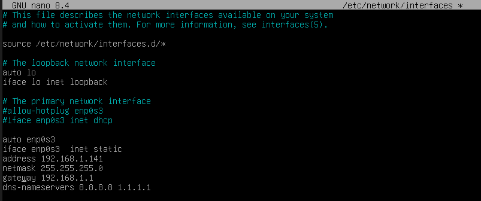

### Captura 2: Verificación de IP y Conectividad

Comprobación mediante ip a para verificar que la IP fue asignada correctamente y prueba de conectividad externa con ping -c 4 8.8.8.8.

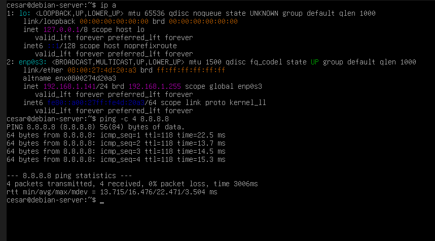

---

## 2. Gestión de Usuarios, Grupos y Permisos

Se aplicó el principio de mínimo privilegio creando usuarios dedicados, asignando roles con sudo y estableciendo un grupo colaborativo para el directorio del proyecto web.

### Captura 3: Creación de Usuario david y Grupo sudo

Creación del usuario mediante sudo adduser david y asignación de permisos administrativos con sudo usermod -aG sudo david.

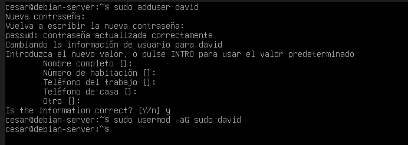

### Captura 4: Asignación Inicial de Propiedad de Directorio

Creación de la estructura del sitio en /var/www/proyecto y asignación de la propiedad al usuario david.

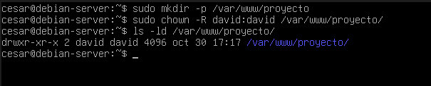

### Captura 5: Grupo Personalizado desarrolladores

Creación del grupo desarrolladores, inclusión de los usuarios cesar y david, y actualización del propietario del grupo del directorio web.

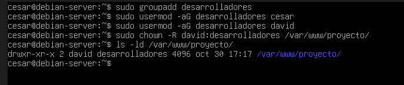

---

## 3. Acceso Remoto Seguro (SSH)

Se aplicaron técnicas de hardening (endurecimiento) sobre el servicio SSH modificando /etc/ssh/sshd_config para prevenir ataques automatizados y accesos no autorizados.

### Captura 6: Modificación de la Configuración SSH (sshd_config)

Edición con nano aplicando las directivas de seguridad para el puerto y acceso de superusuario.

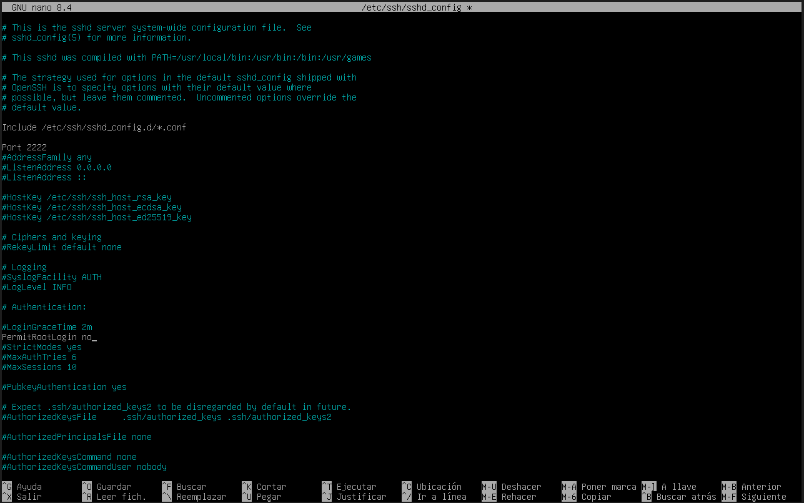

### Captura 7: Prueba de Conexión Remota Exitosa

Acceso remoto desde la máquina anfitriona hacia el servidor Debian usando ssh cesar@192.168.1.141 -p 2222.

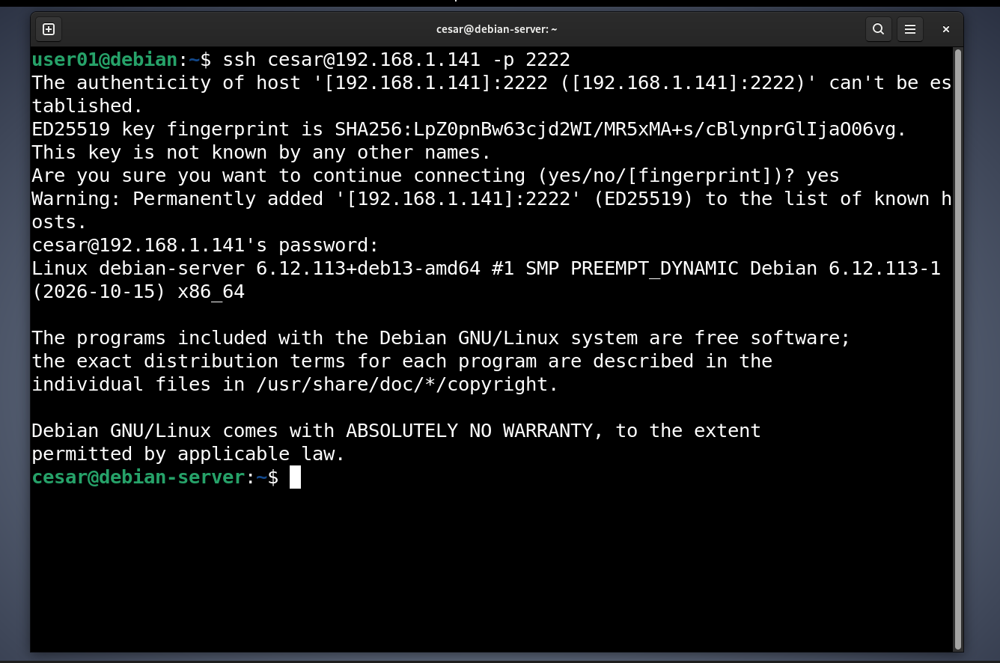

---

## 4. Despliegue del Servidor Web Apache2

Se instaló y verificó el servidor de páginas web HTTP apache2.

### Captura 8: Estado Activo del Servicio Apache2

Comprobación del estado del servicio con sudo systemctl status apache2, mostrando el indicador active (running).

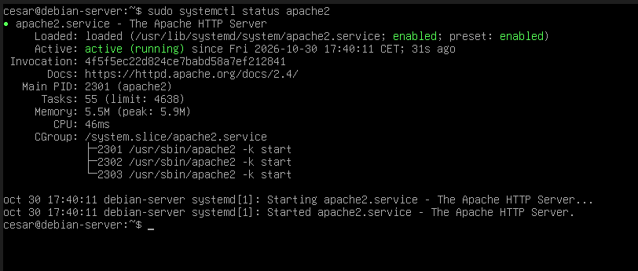

### Captura 9: Acceso Web desde el Navegador Anfitrión

Visualización exitosa de la página por defecto de Apache cargando la IP http://192.168.1.141 en el navegador del equipo local.

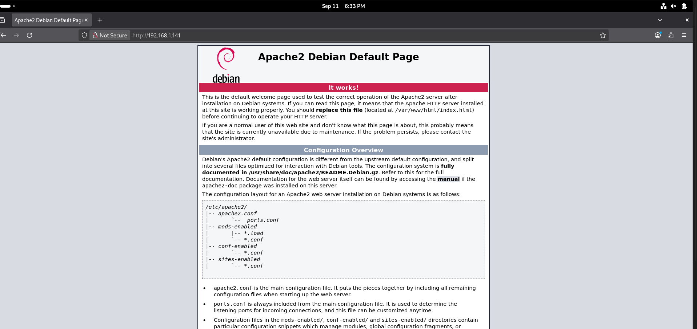

---

## 5. Seguridad y Cortafuegos (UFW)

Se implementó el cortafuegos UFW (Uncomplicated Firewall) aplicando una política defensiva de bloqueo por defecto y permitiendo únicamente los servicios indispensables.

### Captura 10: Estado y Reglas Activas de UFW

Salida detallada obtenida con sudo ufw status verbose confirmando la política y los puertos abiertos.

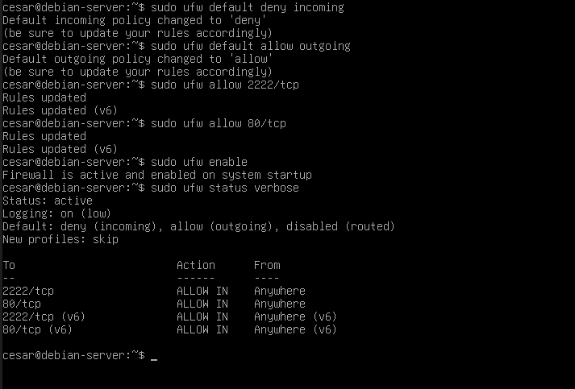

---

## 6. Automatización de Copias de Seguridad (Bash & Cron)

Se desarrolló un script en Bash (backup.sh) enfocado en la creación automatizada de copias de seguridad comprimidas (.tar.gz) con marcas temporales únicas.

``` 
#!/bin/bash
DIR_ORIGEN="/var/www/proyecto"
DIR_DESTINO="/var/backups/proyecto"
FECHA=$(date +%Y-%m-%d_%H-%M-%S)
ARCHIVO_BACKUP="$DIR_DESTINO/backup-proyecto-$FECHA.tar.gz"

echo "Iniciando copia de seguridad de $DIR_ORIGEN..."
tar -czf "$ARCHIVO_BACKUP" "$DIR_ORIGEN"

if [ $? -eq 0 ]; then
    echo "¡Copia de seguridad completada con éxito: $ARCHIVO_BACKUP!"
else
    echo "Error al generar la copia de seguridad"
fi
```

### Captura 11: Código Fuente del Script

Edición y estructura de control del script backup.sh.

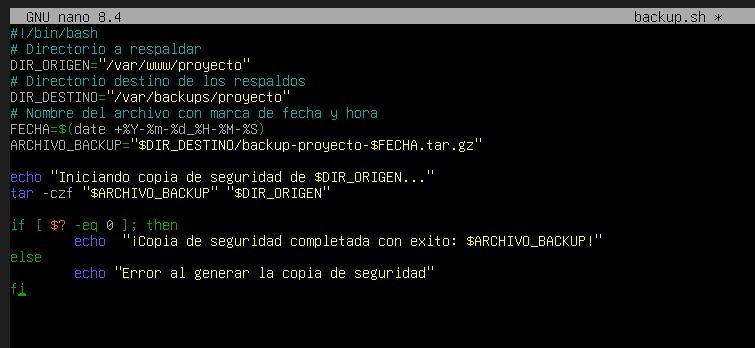

### Captura 12: Ejecución Manual del Respaldo

Prueba de ejecución manual mediante sudo ./backup.sh mostrando los mensajes de éxito en la terminal.

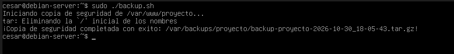

### Captura 13: Verificación del Archivo Comprimido

Comprobación con ls -lh /var/backups/proyecto/ que muestra el archivo generado con su fecha y hora.

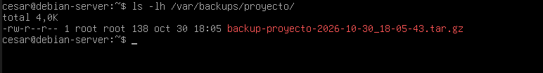

### Captura 14: Tarea Programada en Cron (crontab)

Programación automática de la tarea en el demonio Cron (crontab -l) fijada para ejecutarse a las 2:00 AM (0 2 * * *).

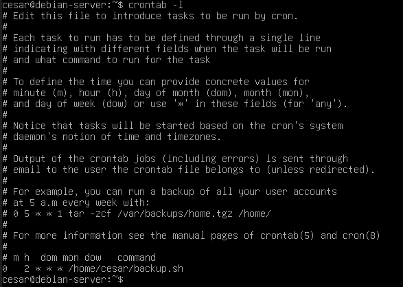

---

## 7. Monitorización y Gestión de Logs

Para el diagnóstico de incidencias y análisis de eventos del sistema, se utilizó journalctl para examinar la actividad del servicio web.

### Captura 15: Inspección de Logs del Servicio

Consulta de eventos recientes mediante sudo journalctl -u apache2 -n 20 --no-pager.

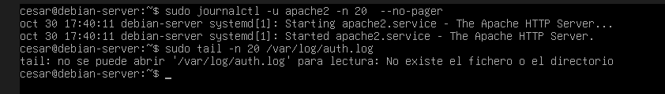

---

## Tecnologías Utilizadas

* Sistema Operativo: Debian GNU/Linux

* Servidor Web: Apache2

* Seguridad: OpenSSH, UFW Firewall

* Scripting: Bash, GNU Tar

* Automatizacion: Cron


