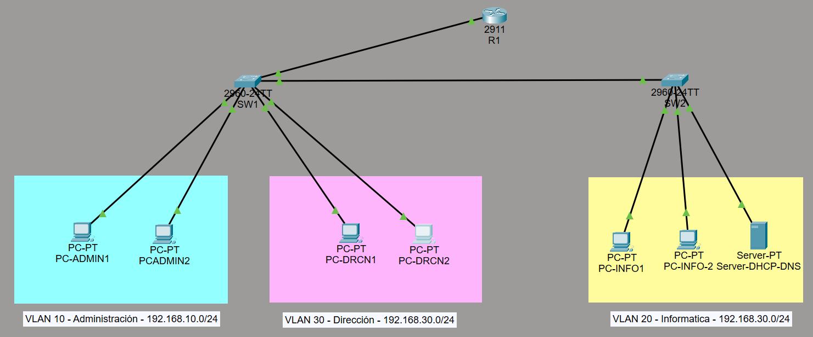
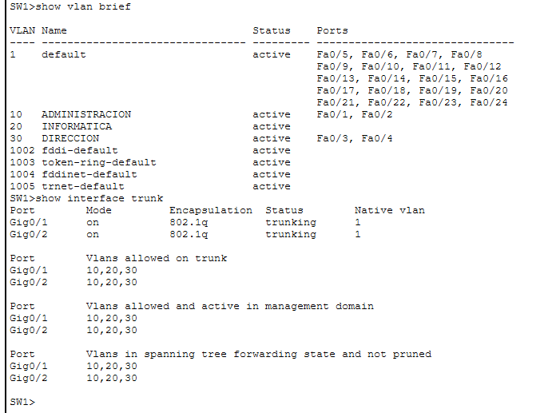
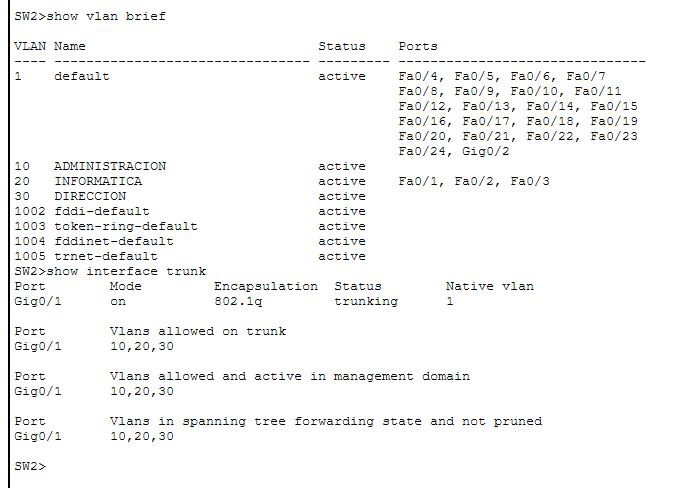
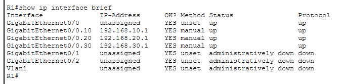
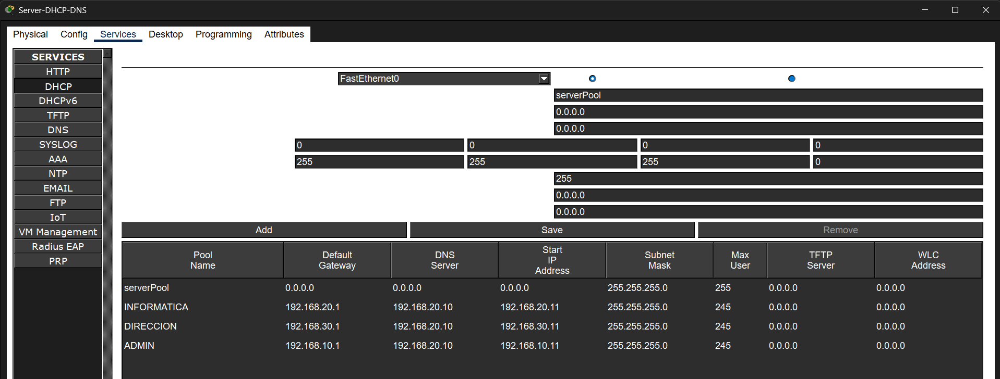
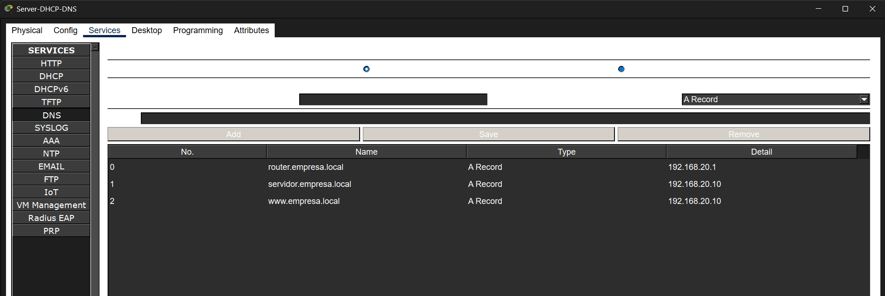
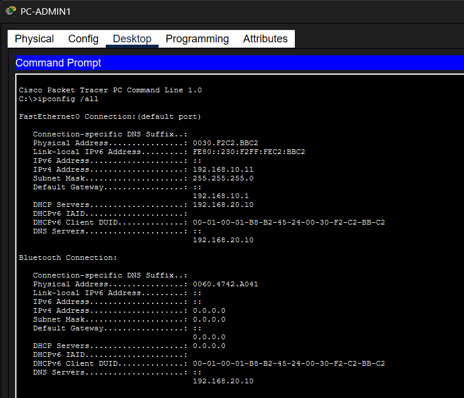
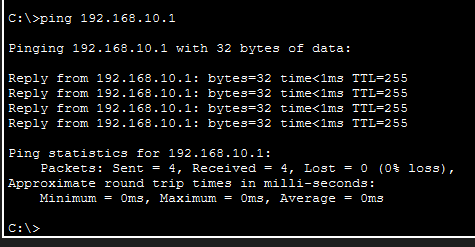
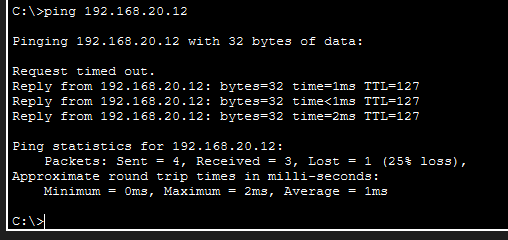
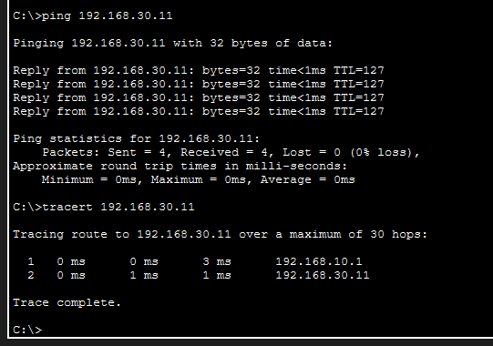

# Red empresarial: DHCP, DNS y VLAN

Este repositorio contiene la documentación técnica completa y las evidencias de la red de una pequeña empresa con segmentación por VLANs, direccionamiento automático mediante DHCP, resolución de nombres con DNS y enrutamiento inter-VLAN en Cisco Packet Tracer.

---

## 1. Topología de Red

La infraestructura de red consta de un router central (`R1`), dos switches de acceso (`SW1` y `SW2`), y un servidor central que proporciona los servicios de DHCP y DNS. Los departamentos se han segmentado en tres redes virtuales independientes:
* **VLAN 10** - Administración (`192.168.10.0/24`)
* **VLAN 20** - Informática (`192.168.20.0/24`)
* **VLAN 30** - Dirección (`192.168.30.0/24`)

### Captura 1: Topología General en Cisco Packet Tracer
Diseño de la topología con los departamentos divididos por colores, etiquetas de red y conexiones activas.

---

## 2. Configuración de Switches y Puertos Trunk

Se configuraron los puertos de acceso asignando cada interfaz a su respectiva VLAN y se establecieron los enlaces troncales (Trunk) utilizando el estándar 802.1Q entre los switches y el router.

### Captura 2: Configuración del Switch 1 (SW1)
Verificación de las VLANs creadas y los puertos troncales activos mediante los comandos `show vlan brief` y `show interface trunk`

### Captura 3: Configuración del Switch 2 (SW2)
Verificación de las VLANs y el estado del enlace troncal en el Switch 2.

---

## 3. Configuración del Router (Router-on-a-Stick)

Se habilitaron subinterfaces virtuales en el puerto físico `GigabitEthernet0/0` del router para que actúen como puertas de enlace (Gateways) de cada departamento y se aplicó el comando `ip helper-address` para reenviar las peticiones DHCP al servidor central.

### Captura 4: Verificación de Interfaces del Router
Comprobación mediante `show ip interface brief` de que las subinterfaces de las tres VLANs se encuentran operativas (`up/up`).

---

## 🖥️ 4. Configuración de Servicios (Servidor DHCP y DNS)

En el servidor central se configuraron de forma simultánea los servicios de direccionamiento automático y resolución de nombres para toda la compañía.

### Captura 5: Pools de Direccionamiento DHCP
Configuración de los rangos de IP automáticos (pools) independientes para Administración, Informática y Dirección.

### Captura 6: Registros DNS
Configuración de los registros de tipo A para la resolución de nombres de dominio dentro de la red local (ej. `servidor.empresa.local`, `router.empresa.local`).

---

## 5. Pruebas de Funcionamiento y Conectividad

### Captura 7: Asignación Automática por DHCP
Comprobación mediante el comando `ipconfig /all` en la PC de Administración, verificando la recepción automática de su dirección IP, máscara de subred, puerta de enlace y servidor DNS.

### Captura 8: Prueba de Conectividad con la Puerta de Enlace
Ejecución de un `ping` exitoso desde `PC-ADMIN1` hacia su respectivo Gateway (`192.168.10.1`).

### Captura 9: Prueba de Enrutamiento Inter-VLAN
Comprobación de comunicación entre diferentes subredes mediante un `ping` exitoso hacia otra VLAN.

### Captura 10: Prueba de Ruta con Tracert
Comprobación mediante `tracert` confirmando que el tráfico entre VLANs pasa de forma correcta a través del primer salto correspondiente a la puerta de enlace (`192.168.10.1`).

---

## Resumen de Tecnologías Implementadas

- **Simulador:** Cisco Packet Tracer[cite: 12]
- **Segmentación:** VLANs (802.1Q Trunks)
- **Enrutamiento:** Router-on-a-Stick (`ip helper-address`)
- **Servicios de Red:** Servidor DHCP y DNS centralizado
- **Pruebas de Red:** `ping`, `ipconfig /all`, `tracert`